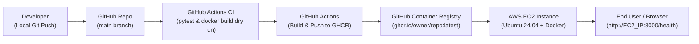

# FastAPI DevOps Lab: End-to-End CI/CD & AWS Deployment Guide

A beginner-friendly, production-aware guide demonstrating how to build, containerize, test, automate with GitHub Actions, publish to GitHub Container Registry (GHCR), and deploy a FastAPI application to AWS EC2.

---

## Architecture Overview



---

## Project Structure

```text
fastapi-devops-lab/
├── .github/
│   └── workflows/
│       ├── ci.yml                 # CI Workflow: Runs pytest & verifies Docker build
│       └── publish-image.yml      # CD Workflow: Builds & pushes Docker image to GHCR
├── app/
│   ├── __init__.py                # Package initializer
│   └── main.py                    # FastAPI application endpoints
├── tests/
│   ├── __init__.py                # Tests package initializer
│   └── test_health.py             # Pytest tests with FastAPI TestClient
├── .dockerignore                  # Files excluded from Docker context
├── .env.example                   # Sample environment configuration
├── .gitignore                     # Git ignore rules for Python & secrets
├── Dockerfile                     # Multi-layer Dockerfile (Python slim, non-root user)
├── pyproject.toml                 # uv project configuration
└── requirements.txt               # Application and testing dependencies
```

---

## 1. Deep Dive: GitHub Actions Workflows

GitHub Actions automates your software development lifecycle. In this project, we have two distinct workflows:

### Workflow 1: Continuous Integration (`.github/workflows/ci.yml`)

#### Purpose
Acts as a quality gatekeeper. Whenever any code is pushed or a pull request is submitted, it ensures all tests pass and the container builds before the code is accepted.

#### Line-by-Line Explanation

| YAML Section | What It Means & Why We Use It |
| :--- | :--- |
| `name: CI` | The display name visible under the **Actions** tab on GitHub. |
| `on: push: branches: [ "main" ]`<br>`pull_request: branches: [ "main" ]` | **Triggers:** Runs automatically when commits are pushed directly to `main` or when someone creates a pull request targeting `main`. |
| `jobs: build-and-test:` | Defines an independent execution pipeline named `build-and-test`. |
| `runs-on: ubuntu-latest` | Allocates a fresh, isolated GitHub-hosted virtual machine running Ubuntu. |
| `uses: actions/checkout@v4` | Clones your GitHub repository into the virtual machine's working directory. |
| `uses: actions/setup-python@v5`<br>`with: python-version: "3.12"` | Installs Python 3.12 on the runner. |
| `cache: "pip"` | Caches pip packages between workflow runs to make builds faster. |
| `python -m pip install --upgrade pip`<br>`pip install -r requirements.txt` | Installs FastAPI, Uvicorn, pytest, and HTTPX dependencies. |
| `pytest` | Runs the test suite in `tests/test_health.py`. If any assertion fails, the entire workflow fails with a red cross. |
| `docker build -t fastapi-devops-lab:test .` | **Dry-run build:** Validates that the Dockerfile has no syntax errors and all dependencies install cleanly. Does **not** push to any registry. |

---

### Workflow 2: Container Publishing (`.github/workflows/publish-image.yml`)

#### Purpose
Acts as the Continuous Delivery (CD) mechanism. When verified code merges into `main`, it builds the final Docker container image and publishes it to GitHub Container Registry (GHCR).

#### Line-by-Line Explanation

| YAML Section | What It Means & Why We Use It |
| :--- | :--- |
| `name: Publish Docker Image` | The display name in the GitHub Actions tab. |
| `on: push: branches: [ "main" ]` | **Trigger:** Only triggers on pushes/merges to `main`. It does **not** run on Pull Requests, preventing untrusted code from publishing images. |
| `permissions:`<br>`contents: read`<br>`packages: write` | **Least-Privilege Security:** Grants read access to repository code and write access to GitHub Packages (GHCR). |
| `uses: docker/setup-buildx-action@v3` | Sets up Docker BuildKit for faster builds, multi-layer caching, and advanced image features. |
| `uses: docker/login-action@v3` | Logs into `ghcr.io` securely. |
| `username: ${{ github.actor }}`<br>`password: ${{ secrets.GITHUB_TOKEN }}` | Uses the runner's built-in, temporary authentication token. **No personal access tokens (PAT) or exposed passwords needed.** |
| `uses: docker/metadata-action@v5` | Automatically extracts repository metadata and generates Docker tags. |
| `images: ghcr.io/${{ github.repository }}` | Target image URI (automatically converts uppercase repository names to valid lowercase Docker paths). |
| `type=raw,value=${{ github.sha }}`<br>`type=raw,value=latest` | Generates two tags: <br>1. **Git SHA:** An immutable, unique fingerprint for full traceability.<br>2. **latest:** Always points to the newest build on `main`. |
| `uses: docker/build-push-action@v6` | Builds the image using Buildx and pushes it directly to GHCR with the generated tags. |

---

## 2. Deep Dive: AWS EC2 Setup & Architecture

### Key AWS Concepts Explained

- **EC2 (Elastic Compute Cloud):** A virtual server (virtual machine) hosted in an AWS data center.
- **AMI (Amazon Machine Image):** A pre-configured operating system template. We selected **Ubuntu Server 24.04 LTS**.
- **Instance Type (`t2.micro`):** 1 virtual CPU and 1 GB RAM. Eligible for the AWS Free Tier (750 hours/month free for the first 12 months).
- **Security Group:** A virtual firewall controlling incoming (inbound) and outgoing (outbound) traffic to your server.

---

### Security Group Inbound Rules Explained

| Type | Port Range | Source | Why This Is Needed & How It Works |
| :--- | :--- | :--- | :--- |
| **SSH** | `22` | `Anywhere-IPv4` (`0.0.0.0/0`) | **Powers EC2 Instance Connect:** When connecting via the AWS Console browser terminal, the traffic comes from AWS's browser proxy servers. If you set this to "My IP", AWS's browser terminal is blocked and reports `"Failed to connect to your instance"`. |
| **Custom TCP** | `8000` | `Anywhere-IPv4` (`0.0.0.0/0`) | **Allows Web Access:** Opens port 8000 so web browsers and curl can reach your FastAPI application running on the server. |

---

## 3. Deep Dive: EC2 Terminal Commands

Every command executed inside the EC2 Ubuntu terminal, explained line-by-line:

### Command 1: Update the Package Repository
```bash
sudo apt-get update
```
- **Why:** Ubuntu maintains a list of downloadable packages. Over time, new security patches and package versions are released. This command synchronizes the local index with the official Ubuntu servers.

### Command 2: Install Docker Engine
```bash
sudo apt-get install -y docker.io
```
- **Why:** Installs the Docker daemon (`dockerd`) and the Docker command-line interface (`docker`).
- **`-y` Flag:** Automatically answers "yes" to all installation prompts so the command runs unattended.

### Command 3: Start and Enable Docker
```bash
sudo systemctl enable --now docker
```
- **Why:** `systemctl` manages Linux background services.
- **`--now`:** Starts the Docker service immediately.
- **`enable`:** Ensures Docker automatically starts if the virtual machine is ever rebooted.
- *(Note: In Linux, no output on this command indicates 100% success).*

### Command 4: Pull Your Container Image from GHCR
```bash
sudo docker pull ghcr.io/<owner>/<repo>:latest
```
- **Why:** Contacts GitHub Container Registry over HTTPS and downloads the container image layers built by your GitHub Actions workflow.
- **Public Package:** Because the package visibility was set to Public on GitHub, Docker can pull it freely without requiring authentication credentials to be saved on the EC2 instance.

### Command 5: Tag with a Short Name (Troubleshooting Pitfall Solved)
```bash
sudo docker tag ghcr.io/<owner>/<repo>:latest app
```
- **Why:** Web-based terminals (like EC2 Instance Connect) often insert unwanted line breaks and newlines when pasting long strings, resulting in errors like `docker: invalid reference format`.
- **Solution:** Tagging creates an alias named `app` pointing to the exact same image, allowing concise and foolproof execution.

### Command 6: Run the Container
```bash
sudo docker run -d --name fastapi-app -p 8000:8000 --restart unless-stopped app
```
- **`-d` (Detached):** Runs the container in the background so your shell prompt remains free.
- **`--name fastapi-app`:** Assigns a friendly, memorable container name.
- **`-p 8000:8000`:** Port mapping: `[Host Port]:[Container Port]`. Any traffic arriving at the EC2 public IP on port 8000 is forwarded directly to port 8000 inside the container where Uvicorn is listening.
- **`--restart unless-stopped`:** Production resilience: If the container crashes or the server restarts, Docker automatically brings the container back up.
- **`app`:** The image alias to run.

### Command 7: Inspect Container Logs
```bash
sudo docker logs fastapi-app
```
- **Why:** Displays the console output produced by the container. Confirmed that Uvicorn started:
  ```text
  INFO:     Started server process [1]
  INFO:     Waiting for application startup.
  INFO:     Application startup complete.
  INFO:     Uvicorn running on http://0.0.0.0:8000 (Press CTRL+C to quit)
  ```

### Command 8: Verify Application Health
```bash
# From within the EC2 terminal:
curl http://localhost:8000/health

# From any web browser on your personal computer:
http://<EC2_PUBLIC_IPV4>:8000/health
http://<EC2_PUBLIC_IPV4>:8000/docs
```
- **Why:** Validates that the entire network path (Browser -> AWS Internet Gateway -> Security Group -> Docker Port 8000 -> FastAPI -> Response) is completely functional.

---

## 4. Teardown & Cost Management

### Terminating the EC2 Instance
1. Go to **AWS Console** > **EC2** > **Instances**.
2. Select your instance > **Instance state** > **Terminate instance**.

### What Happens Behind the Scenes:
- **Instant Billing Halt:** The second status changes to `Shutting-down` or `Terminated`, compute billing drops to **$0.00**.
- **Storage Deletion:** The 8 GB EBS root volume is automatically destroyed, preventing ongoing storage charges.
- **Container Cleanup:** You do not need to run `docker stop` or `docker rm`; the entire virtual hard drive is destroyed.
- **Console Delay:** AWS keeps terminated instances visible in the console with status **Terminated** for **30 to 60 minutes** before disappearing. This is purely an audit log and **does not incur any charges**.

---

## 5. Troubleshooting Reference

| Issue Encountered | Root Cause | Exact Solution |
| :--- | :--- | :--- |
| **"Failed to connect to your instance"** | Inbound SSH (port 22) was restricted to "My IP", blocking EC2 Instance Connect browser proxies. | Set SSH (port 22) source to `0.0.0.0/0` in the Security Group. |
| **Terminal disconnected after opening port 8000** | The SSH rule was accidentally removed or overwritten while editing inbound rules. | Ensure **both** rules exist: Port 22 (`0.0.0.0/0`) and Port 8000 (`0.0.0.0/0`). |
| **`docker: invalid reference format`** | Terminal wrapped the long GHCR URL across multiple lines on paste. | Create a short alias: `sudo docker tag <long-url> app`, then run `app`. |
| **`403 Forbidden` when pushing to GHCR** | Repository default did not allow GitHub Actions workflows to write packages. | Under GitHub repo **Settings** > **Actions** > **General**, select **Read and write permissions**. |
